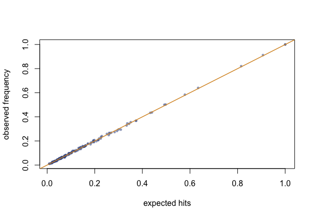

<!-- Generated from validation.Rmd.orig by tools/precompute-vignettes.R; edit the .orig file. -->


A sampling package must earn trust the design-based way: the inclusion
probabilities it claims must be the ones it delivers. This vignette checks
the package's promises by simulation — every number below is recomputed
when the vignette is built.


``` r
library(chromy)
set.seed(20261022)
```

## The sample size is always exact

Not on average: always. Ten thousand selections, every one with exactly the
expected hits it was asked for.


``` r
frame <- data.frame(size = rlnorm(150, 2))
n_hits <- replicate(10000, {
  s <- chromy_sample(frame, n = 23, size = "size")
  sum(s$sample$hits)
})
table(n_hits)
#> n_hits
#>    23 
#> 10000
```

## Expected hits are delivered

For each unit, the fraction of selections in which it was hit must converge
to its expected hits. The largest absolute deviation over the whole frame,
against the Monte Carlo error it should sit within:


``` r
lambda <- expected_hits(frame$size, 23)
hits <- matrix(0L, 4000, nrow(frame))
for (r in seq_len(nrow(hits))) {
  s <- chromy_sample(frame, n = 23, size = "size")
  hits[r, s$sample$unit] <- s$sample$hits
}
observed <- colMeans(hits)
mc_se <- sqrt(lambda * (1 - lambda) / nrow(hits))

max(abs(observed - lambda))
#> [1] 0.01554681
max(abs(observed - lambda) / pmax(mc_se, 1e-6))   # in Monte Carlo SEs
#> [1] 2.430212
```


``` r
plot(lambda, observed,
  xlab = "expected hits", ylab = "observed frequency",
  pch = 16, col = "#35508C88", cex = 0.7
)
abline(0, 1, col = "#D9962E", lwd = 1.5)
```

<div class="figure">

<p class="caption">Figure of the chunk unbiased-plot</p>
</div>

## Minimum replacement holds

Hits never stray further than one from the expectation, including for units
expected more than once:


``` r
heavy <- data.frame(size = c(900, 500, rlnorm(60, 2)))
ok <- replicate(2000, {
  s <- chromy_sample(heavy, n = 12, size = "size",
                     min_replacement = TRUE)
  all(s$sample$hits == floor(s$sample$expected_hits) |
      s$sample$hits == ceiling(s$sample$expected_hits))
})
all(ok)
#> [1] TRUE
```

## The estimator is unbiased and the variance honest

The multiplicity estimator must centre on the true total; the
successive-difference variance has no unbiasedness to promise under a
systematic-like design, but it should sit near the Monte Carlo variance —
and err on the conservative side when the serpentine order carries real
structure.


``` r
pop <- data.frame(
  stratum = rep(sprintf("s%02d", 1:10), each = 30),
  size    = rlnorm(300, 2)
)
pop$y <- 50 + 10 * pop$size + rnorm(300, sd = 15)
truth <- sum(pop$y)

runs <- t(replicate(2000, {
  s <- chromy_sample(pop, n = 50, size = "size",
                     order_by = c("stratum", "chromy_size"))
  e <- estimate_total(s, "y")
  c(total = e$total, var = e$se^2)
}))

c(
  relative_bias   = mean(runs[, "total"]) / truth - 1,
  empirical_var   = var(runs[, "total"]),
  mean_sd_var     = mean(runs[, "var"]),
  variance_ratio  = mean(runs[, "var"]) / var(runs[, "total"])
)
#>  relative_bias  empirical_var    mean_sd_var variance_ratio 
#>   5.229982e-04   2.682902e+06   4.660619e+06   1.737156e+00
```

A ratio near one says the successive-difference variance is a fair report;
above one, a conservative one.

## The reference implementation

The package was distilled from a reference R implementation, kept verbatim
in the test suite (`tests/testthat/helper-reference.R`) as an oracle: given
the same seed, `chromy_sample()` must reproduce it draw for draw — the same
head, the same uniforms, the same hits — across size-column, multivariate,
serpentine, nested, residual-head and minimum-replacement designs. The Rust
engine is itself pinned to the same reference by golden fixtures
(`tests/golden.rs` in `chromy-core`), with the integer outputs exact and
the floating-point outputs at machine precision. A SAS or Stata user can
check the procedure against `PROC SURVEYSELECT METHOD=PPS_SEQ` or
`ppschromy` on their own frames; the designs agree in distribution, though
not draw for draw, since each system consumes its own generator.
